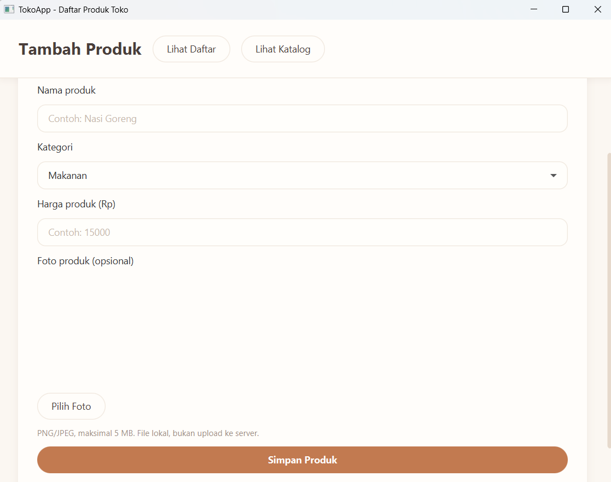
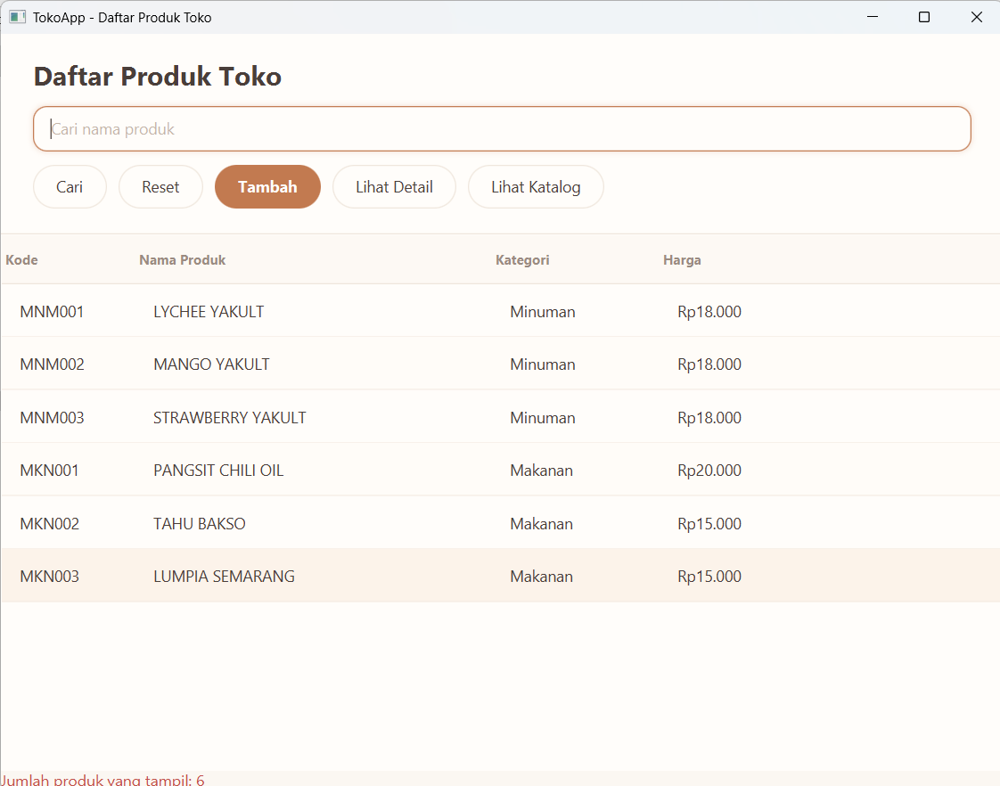
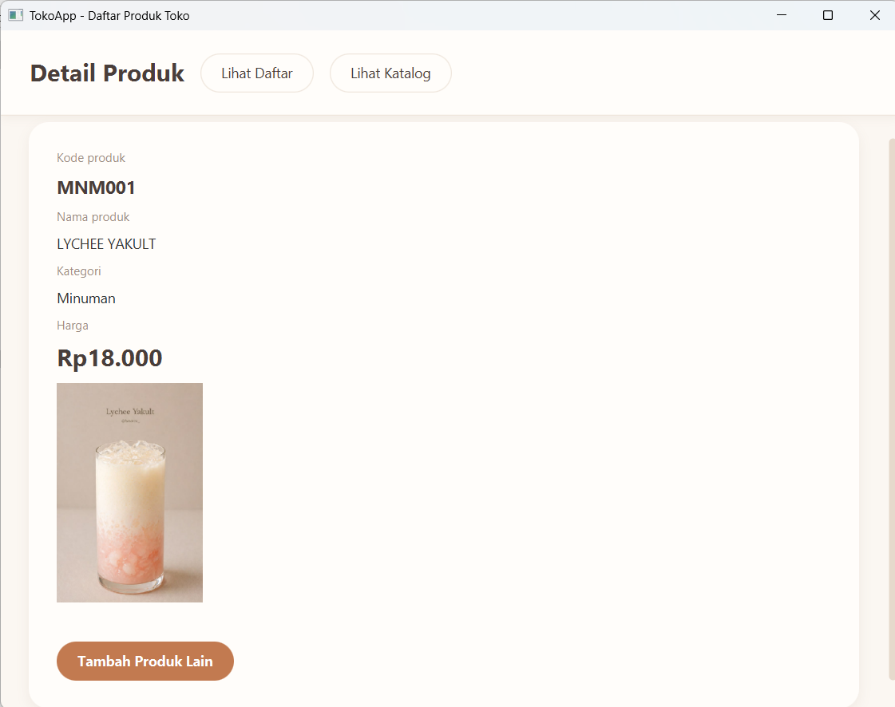

# TokoApp

### Yuk, kelola produk toko dengan lebih mudah!

TokoApp adalah aplikasi desktop sederhana yang membantu anda mengelola data produk toko. Di aplikasi ini, anda bisa menambahkan produk makanan dan minuman, melihat daftar produk, mencari produk, sampai melihat detail dan katalog produk.

Aplikasi ini dibuat menggunakan **Java dan JavaFX** dengan tampilan yang simpel dan mudah digunakan. Kode produk juga dibuat secara otomatis berdasarkan kategori, jadi anda tidak perlu mengisinya sendiri!

---

## Tampilan Aplikasi

### Form Tambah Produk

Halaman untuk menambahkan produk baru. anda bisa mengisi nama produk, memilih kategori, memasukkan harga, dan memilih foto produk.



### Daftar Produk

Menampilkan semua produk yang sudah ditambahkan dalam bentuk tabel. Ada juga fitur pencarian untuk memudahkan anda menemukan produk berdasarkan nama.



### Detail Produk

Menampilkan informasi lebih lengkap dari produk yang dipilih, seperti kode, nama, kategori, harga, dan foto produk jika tersedia.



### Katalog Produk

Menampilkan produk dalam bentuk kartu supaya katalog lebih mudah dilihat. Setiap kartu berisi informasi produk dan pilihan untuk melihat detailnya.


---

## Fitur Aplikasi

- Menambahkan produk dengan kategori Makanan atau Minuman
- Membuat kode produk secara otomatis berdasarkan kategori
- Menggunakan format kode `MKN001` untuk Makanan dan `MNM001` untuk Minuman
- Memilih foto produk dari perangkat
- Menampilkan daftar produk dalam bentuk tabel
- Mencari produk berdasarkan nama
- Melihat detail informasi produk
- Menampilkan katalog produk dalam bentuk kartu

---

## Cara Menjalankan Aplikasi

### Persiapan

Pastikan laptop anda sudah memiliki:

- JDK 17 atau versi yang kompatibel
- Apache Maven
- NetBeans (opsional, jika ingin menjalankan melalui IDE)

### Langkah-langkah

**1. Clone repository**

```bash
git clone https://github.com/ofidefiyanti/Produk-Toko-App.git
```

**2. Masuk ke folder project**

```bash
cd TokoApp
```

**3. Jalankan aplikasi**

```bash
mvn clean javafx:run
```

Tunggu sampai Maven selesai menyiapkan dependency yang dibutuhkan. Setelah itu, aplikasi TokoApp akan terbuka.

### Menjalankan melalui NetBeans

1. Buka NetBeans.
2. Pilih **File → Open Project**.
3. Pilih folder project yang berisi file `pom.xml`.
4. Tunggu sampai proses loading dan dependency Maven selesai.
5. Klik kanan project, lalu pilih **Run**.

---

## Tentang Project

Project ini dibuat sebagai bagian dari pembelajaran pemrograman Java. Melalui project ini, beberapa konsep yang dipelajari dan diterapkan antara lain:

- Object-Oriented Programming (OOP)
- Abstract class dan inheritance
- Encapsulation
- Polymorphism
- Pembuatan tampilan aplikasi menggunakan JavaFX
- Event handling
- Penggunaan FXML dan CSS
- Pengelolaan project menggunakan Maven

---

## Pengembang

**Ofi Defiyanti**

Project Pemrograman Java | 2026

---
print(f"README berhasil dibuat: {path}")

